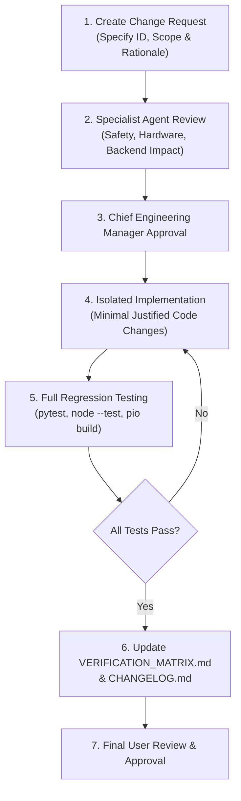

# Change Request & Engineering Management Protocol

- Document ID: MGT-CRU-001
- Version: 1.0.0
- Date: 2026-11-01
- Project: Remote Patient Vital Signs Monitoring System (RPMIOMTproject)
- Author: Chief Engineering Manager

---

## 1. Purpose & Principles

This document defines the formal change management process for the RPMIOMTproject codebase, firmware, schemas, and documentation.
To safeguard patient data integrity and system reliability, all future modifications must follow this protocol.

### Fundamental Engineering Tenets:
1. **Zero Fabrication**: No change shall permit the generation or display of synthetic vital signs when sensor signals are missing or invalid.
2. **Clinical Temperature Segregation**: No change shall map raw TMP117 sensor data directly to core body temperature or re-enable fever screening without clinical validation.
3. **Non-Destructive Git Practice**: No branch resets, force pushes, or wholesale deletion of established work.
4. **Mandatory Regression Verification**: Every change must pass 100% of the automated test suite before approval.

---

## 2. Change Request (CR) Lifecycle Workflow



---

## 3. Impact Assessment Checklist

Before approving any Change Request, the specialist engineers must verify:

- [ ] **Clinical Safety**: Does the change introduce any risk of misinterpreting prototype data as medical diagnosis?
- [ ] **I2C Bus Contention**: Does the change alter I2C bus speeds, addresses, or blocking durations?
- [ ] **Telemetry Schemas**: Does the change break JSON packet schemas or SQLite table contracts?
- [ ] **UI Masking**: Does the UI continue to display "--" / "Not connected" for invalid or missing values?
- [ ] **Automated Tests**: Are new unit tests added to cover the modified code path?

---

## 4. Standard Change Request Template

When proposing a change, format the submission as follows:

```markdown
### CR-[ID]: [Descriptive Title]
- **Date**: YYYY-MM-DD
- **Proposer**: [Specialist Agent Name / User]
- **Affected Subsystems**: [Firmware / Backend / Frontend / Diagnostics]
- **Motivation & Problem Statement**:
  [Explain the concrete problem or enhancement required]
- **Proposed Solution**:
  [Describe the specific minimal code/config modification]
- **Risk & Safety Assessment**:
  [Detail any potential failure modes or clinical considerations]
- **Verification Plan**:
  [List exact unit test commands and bench procedures]
```

