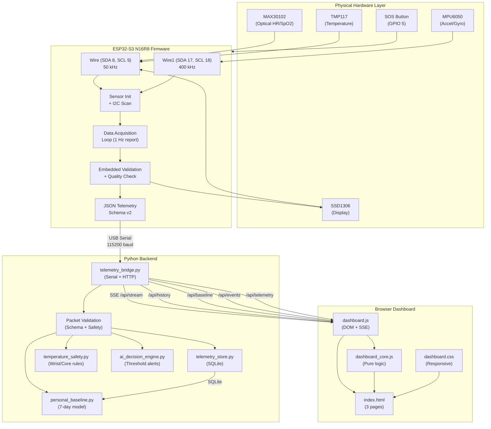

# SYSTEM ARCHITECTURE — RPMIOMTproject

## Data flow diagram

## Component detail

### 1. ESP32-S3 Firmware (`src/main.cpp`)

| Aspect | Detail |
|:---|:---|
| Purpose | Initialize sensors, collect raw data, validate, produce JSON telemetry |
| Input | I2C sensor registers, GPIO 5 button state |
| Output | Serial JSON at 115200 baud, OLED display |
| Dependencies | `sensor_math.h`, `tmp117_protocol.h`, SparkFun MAX3010x, Adafruit SSD1306/GFX |
| Current status | Builds successfully; HARDWARE VERIFICATION REQUIRED |
| Files | `src/main.cpp`, `src/sensor_math.h`, `src/tmp117_protocol.h` |

### 2. TMP117 Protocol (`src/tmp117_protocol.h`)

| Aspect | Detail |
|:---|:---|
| Purpose | Pure TMP117 register definitions and conversion helpers |
| Input | Raw 16-bit register values |
| Output | Celsius temperature, validation booleans |
| Dependencies | `<stdint.h>` only |
| Verification | 14 compile-time `static_assert` vectors |
| Key formula | `celsius = (int16_t)raw × 0.0078125` |

### 3. Sensor Math (`src/sensor_math.h`)

| Aspect | Detail |
|:---|:---|
| Purpose | MPU and MAX30102 conversion + signal quality helpers |
| Key constants | `MPU_ACCEL_LSB_PER_G=4096` (±8g), `MPU_GYRO_LSB_PER_DPS=131` (±250 dps) |
| MAX30102 quality | DC range 50k–262k, AC ≥ 1000, PI ≥ 0.10% |
| Verification | 13 compile-time assertions |

### 4. Python Telemetry Bridge (`telemetry_bridge.py`)

| Aspect | Detail |
|:---|:---|
| Purpose | Serial reader → packet validator → SSE broadcaster → HTTP server |
| Input | Serial JSON from ESP32 |
| Output | SSE events, REST APIs, SQLite storage |
| Port | `127.0.0.1:8080` (localhost only) |
| Validation | 100+ checks: schema, types, ranges, status consistency, stuck-bus, duplicate keys, NaN/Inf |
| APIs | `/api/telemetry`, `/api/stream` (SSE), `/api/history`, `/api/baseline`, `/api/events` |

### 5. Telemetry Store (`telemetry_store.py`)

| Aspect | Detail |
|:---|:---|
| Purpose | SQLite persistence of validated measurements |
| Database | `data/telemetry.sqlite3` (local, WAL mode) |
| Storage rule | Only stores values with `valid` status; null otherwise |
| Retention | 30-day auto-prune |
| Migration | Additive schema (new columns don't break old data) |

### 6. Personal Baseline (`personal_baseline.py`)

| Aspect | Detail |
|:---|:---|
| Purpose | 7-day per-metric statistical reference model |
| Method | Median ± max(3 × 1.4826 × MAD, noise floor) |
| Requirements | 7 days × 30 minutes/day per metric independently |
| Deviation events | 3 consecutive outside-range readings → event logged |

### 7. Temperature Safety (`temperature_safety.py`)

| Aspect | Detail |
|:---|:---|
| Purpose | Enforce sensor/wrist/core temperature separation |
| Key rule | `wrist_contact_status=unverified` → wrist value is always null |
| Core temperature | Always null, always `not_available` |
| Fever screening | Always `not_available` with exact message |

### 8. Decision Engine (`ai_decision_engine.py`)

| Aspect | Detail |
|:---|:---|
| Purpose | Threshold-based alert summaries for serial console |
| Thresholds | HR <50 or >120 → WARNING; SpO2 <90 → WARNING; SOS/Fall → EMERGENCY |
| Principle | Never invents missing values; never fabricates core temperature |

### 9. Dashboard (`index.html`, `assets/`)

| Aspect | Detail |
|:---|:---|
| Pages | Overview (live metrics + chart), Baseline (7-day enrollment), Device (sensor inventory) |
| Live data | SSE stream with 1-second updates |
| Charts | Gap-aware SVG with baseline band overlay |
| Temperature display | TMP117 sensor shown separately; wrist "unverified"; core "unavailable" |
| Export | CSV of recorded averages with blank gaps |
| Review | Local clinician review form (browser storage) |

## Interface contracts

### Serial JSON schema (firmware → bridge)

- Line format: `[JSON] {json_object}\n`
- Baud: 115200
- Schema version: 2
- Required top-level keys: `uptime_s`, `device_id`, `schema_version`, `sensors`, `vitals`, `alerts`
- `sensors.active_max` must equal 3
- `sensors.active` must equal count of true values among `max`, `mpu`, `tmp117`
- `sensors.sht40` and `sensors.mlx` must be false

### API contracts (bridge → dashboard)

| Endpoint | Method | Purpose |
|:---|:---|:---|
| `/api/stream` | GET (SSE) | Live telemetry + comparisons |
| `/api/telemetry` | GET | Snapshot of latest packet |
| `/api/history?seconds=N` | GET | Bucketed historical averages |
| `/api/baseline` | GET/POST | Baseline enrollment + summary |
| `/api/events` | GET | Alert and deviation event log |

