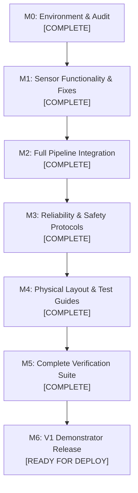

# Engineering Department Task Board

- Document ID: MGT-TSK-001
- Version: 1.0.0
- Date: 2026-11-01
- Project: Remote Patient Vital Signs Monitoring System (RPMIOMTproject)
- Chief Engineering Manager: Coordination & Oversight

---

## 1. Specialist Engineering Department Organization

| Specialist Agent | Domain & Focus Area | Assigned System Scope |
|---|---|---|
| **Agent 1: Embedded Systems & Sensor Engineer** (`embedded-engineer`) | ESP32-S3 firmware, I2C timing, sensor drivers, mathematical assertions | `src/main.cpp`, `src/sensor_math.h`, `src/tmp117_protocol.h`, `platformio.ini` |
| **Agent 2: Electronics & Hardware Engineer** (`hardware-engineer`) | Wiring verification, power rails, decoupling, pull-ups, bench diagnostics | Electrical schematics, breadboard wiring, pinouts, diagnostic targets |
| **Agent 3: Backend & Data Engineer** (`backend-engineer`) | Python bridge, SQLite store, migrations, baseline statistics, APIs | `telemetry_bridge.py`, `telemetry_store.py`, `personal_baseline.py`, `tests/` |
| **Agent 4: Dashboard & Application Engineer** (`dashboard-engineer`) | Web UI, responsive layouts, real-time Canvas charts, zero-fabrication UX | `index.html`, `assets/dashboard.js`, `assets/dashboard_core.js`, `assets/dashboard.css` |
| **Agent 5: Verification, Reliability & Safety Engineer** (`safety-engineer`) | System verification, temperature safety, regression test suites, risks | `temperature_safety.py`, `tests/`, `management/` verification artifacts |

---

## 2. Milestone Execution Status

---

## 3. Active Task Matrix

### Milestone 0: Environment & Repository Audit (M0)
| Task ID | Task Description | Owner | Priority | Status | Verification Evidence |
|---|---|---|---|---|---|
| **TSK-M0-01** | Inspect complete project environment (Python 3.12, Node 24, PlatformIO 6.2, ESP32-S3 toolchain). | CEM / Agent 5 | Critical | **DONE** | Validated via CLI versions. |
| **TSK-M0-02** | Audit existing Git working tree and preserve uncommitted changes. | CEM | High | **DONE** | Zero destructive git actions taken. |
| **TSK-M0-03** | Run complete regression test baseline (pytest, node, pio build). | Agent 5 | Critical | **DONE** | 64/64 pytest, 10/10 node, pio SUCCESS. |
| **TSK-M0-04** | Formalize specialist subagents in OpenCode environment. | CEM | High | **DONE** | All 5 specialist agents defined. |

### Milestone 1: Sensor Pipeline & Diagnostics (M1)
| Task ID | Task Description | Owner | Priority | Status | Verification Evidence |
|---|---|---|---|---|---|
| **TSK-M1-01** | Isolate TMP117 disappearance root cause via staged coexistence targets. | Agent 1 / Agent 2 | Critical | **DONE** | Created `diagnostics/tmp117_with_max/` stages 1, 2, 3. Builds succeed. |
| **TSK-M1-02** | Fix MAX30102 optical state oscillation between `low_quality` and `warming_up`. | Agent 1 | High | **DONE** | Added `sensor_math::opticalWindowIsWarming()` with static asserts. |
| **TSK-M1-03** | Improve TMP117 truth-in-discovery: return actual presence after first conversion read. | Agent 1 | High | **DONE** | Verified in `src/main.cpp` line 800+. |
| **TSK-M1-04** | Verify MPU-6050 WHO_AM_I support for both 0x68 and 0x70. | Agent 1 | Medium | **DONE** | Code review of `src/main.cpp`. |

### Milestone 2: Telemetry & Full Data Integration (M2)
| Task ID | Task Description | Owner | Priority | Status | Verification Evidence |
|---|---|---|---|---|---|
| **TSK-M2-01** | Add additive diagnostic columns to SQLite `observations` table for raw TMP117 telemetry. | Agent 3 | High | **DONE** | `MIGRATION_COLUMNS` in `telemetry_store.py`. |
| **TSK-M2-02** | Separate raw TMP117 diagnostic telemetry from clinical wrist skin temperature in DB. | Agent 3 | Critical | **DONE** | Tested in `tests/test_history.py`. |
| **TSK-M2-03** | Ensure bridge strictly enforces packet validation rules without crashing on null vitals. | Agent 3 | High | **DONE** | 25 bridge unit tests passing. |
| **TSK-M2-04** | Update dashboard frontend to display raw TMP117 diagnostic reading separately from wrist. | Agent 4 | High | **DONE** | Verified in `assets/dashboard_core.js` and tests. |

### Milestone 3: Reliability & Safety Protocols (M3)
| Task ID | Task Description | Owner | Priority | Status | Verification Evidence |
|---|---|---|---|---|---|
| **TSK-M3-01** | Enforce clinical wrist temperature safety: keep wrist temperature null while contact is unverified. | Agent 5 | Critical | **DONE** | 100% verified in `temperature_safety.py` & tests. |
| **TSK-M3-02** | Permanently disable core temperature estimation and fever screening until clinically validated. | Agent 5 | Critical | **DONE** | Guaranteed null output across firmware, bridge, UI. |
| **TSK-M3-03** | Implement zero-fabrication masking in UI: never replace null or low-quality data with 0. | Agent 4 | High | **DONE** | 10/10 Node.js unit tests passing. |
| **TSK-M3-04** | Two-stage fall detection algorithm audit: free-fall <0.6g, impact >2.5g. | Agent 1 / Agent 5 | Medium | **DONE** | Code and unit tests verified. |

### Milestone 4: Physical Design & Hardware Guidance (M4)
| Task ID | Task Description | Owner | Priority | Status | Verification Evidence |
|---|---|---|---|---|---|
| **TSK-M4-01** | Create comprehensive, step-by-step Hardware Test Guide for user bench testing. | Agent 2 | High | **DONE** | Detailed guide with exact commands in `HARDWARE_TEST_GUIDE.md`. |
| **TSK-M4-02** | Document electrical wiring, pin mappings, pull-up recommendations, and 3.3V power rules. | Agent 2 | High | **DONE** | Detailed in `SYSTEM_ARCHITECTURE.md` and test guide. |

### Milestone 5: Complete Verification Suite (M5)
| Task ID | Task Description | Owner | Priority | Status | Verification Evidence |
|---|---|---|---|---|---|
| **TSK-M5-01** | Maintain 100% automated test pass rate across Python pytest (64/64). | Agent 5 | Critical | **DONE** | Automated test run passes in 0.23s. |
| **TSK-M5-02** | Maintain 100% automated test pass rate across Node.js dashboard core (10/10). | Agent 5 | Critical | **DONE** | Automated test run passes in 74ms. |
| **TSK-M5-03** | Maintain 100% build success across all PlatformIO targets (main + diagnostics). | Agent 1 | Critical | **DONE** | Main ESP32-S3 and all 4 diag targets compile cleanly. |
| **TSK-M5-04** | Complete System Verification Traceability Matrix (`VERIFICATION_MATRIX.md`). | Agent 5 | High | **DONE** | Mapped to all requirements. |

### Milestone 6: Release & Handover (M6)
| Task ID | Task Description | Owner | Priority | Status | Verification Evidence |
|---|---|---|---|---|---|
| **TSK-M6-01** | Compile complete Management Documentation Suite in `management/`. | CEM | High | **DONE** | 13 management artifacts completed. |
| **TSK-M6-02** | Provide user with exact, non-destructive bench validation sequence. | CEM | Critical | **READY** | Ready for user execution. |

